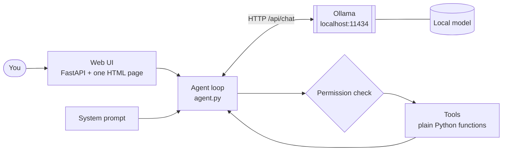

# Build your own local agent

A step-by-step guide for a developer who has never set up an LLM agent. Each step works on its own and ends with something you can run. Stop whenever you have enough; the "v2" section is a menu, not a requirement.

agent0 in this repo is the finished example. Each step names the file to peek at. Longer material lives in [`guide/`](guide/) and is linked from the step that needs it.

## The mental model (read this once)

An agent is three things:

1. **A model** that takes text in and gives text out (here: Ollama, running on your machine).
2. **Tools**: plain functions you write, described to the model as JSON.
3. **A loop**: ask the model → if it asks for a tool, run it, hand back the result → repeat until it answers in plain text.

That's all. Everything else (UI, memory, voice) is ordinary software around that loop.

```
user → [system prompt + history + question] → model
          ↑                                      │ tool_call?
          └──── tool result ◄── run function ◄───┘   no → final answer
```

What you build in v1, and how the parts connect:



Everything runs on your machine. For the flow of one message and the full agent0 architecture (with the v2 parts), see the [diagrams](guide/diagrams.md).

## Step 0: Prerequisites

Python 3.10+, a terminal, a virtual environment and `pip install requests fastapi uvicorn`.

→ **[Prerequisites and project setup](guide/00-prerequisites.md)** (Windows, macOS, Linux)

## Step 1: Install a local model

Install [Ollama](https://ollama.com/download), then `ollama pull qwen3:8b`. Ollama is a local HTTP server on `localhost:11434`; you can reach it from any terminal with `curl`.

- **[Install and verify](guide/01-install-ollama.md)**
- [How Ollama works](guide/how-ollama-works.md)
- [Choose a model for your PC](guide/choose-a-model.md): a prompt that finds a good match for your hardware

## Step 2: Talk to the model

```python
# llm.py
import requests

def chat(messages, tools=None):
    r = requests.post("http://localhost:11434/api/chat", json={
        "model": "qwen3:8b",
        "messages": messages,
        "tools": tools or [],
        "stream": False,
        "options": {"num_ctx": 16384},   # see Gotchas - the default is tiny
    }, timeout=600)
    r.raise_for_status()
    return r.json()["message"]
```

Messages are `{"role": "system" | "user" | "assistant" | "tool", "content": "..."}`. The model is stateless: you resend the whole conversation each call.

*agent0:* `core/llm.py` (adds streaming, structured output, error handling).

## Step 3: Add a system prompt

The system prompt is the first message. It sets role, rules and tool etiquette. Keep it in its own file so you can tune it without touching logic.

```python
# system_prompt.py
SYSTEM_PROMPT = """You are a helpful assistant with access to tools.
Call a tool when you need information; otherwise answer in plain text.
RULES:
- Never guess file paths; search first.
- If a tool result starts with ERROR, fix the arguments and retry.
"""
```

Tip: rules phrased as "NEVER/ALWAYS" are cheap, and you'll add one every time the model misbehaves. That is normal. *agent0:* `config/system_prompt.py`.

## Step 4: Add a tool and the loop (the important step)

A tool = a Python function + a JSON schema telling the model its name and arguments.

```python
# tools.py
from pathlib import Path

def read_file(path: str) -> str:
    try:
        return Path(path).read_text()[:20000]    # cap size, always
    except Exception as e:
        return f"ERROR: {e}"                     # errors go back to the model, not up the stack

TOOLS = {
    "read_file": {
        "func": read_file,
        "schema": {"type": "function", "function": {
            "name": "read_file",
            "description": "Read a text file and return its contents",
            "parameters": {"type": "object",
                           "properties": {"path": {"type": "string"}},
                           "required": ["path"]},
        }},
    },
}
```

```python
# agent.py
from llm import chat
from system_prompt import SYSTEM_PROMPT
from tools import TOOLS

def run_agent(question, max_steps=8):
    messages = [{"role": "system", "content": SYSTEM_PROMPT},
                {"role": "user", "content": question}]
    schemas = [t["schema"] for t in TOOLS.values()]

    for _ in range(max_steps):                       # always bound the loop
        msg = chat(messages, schemas)
        messages.append(msg)
        if not msg.get("tool_calls"):
            return msg["content"]                    # done
        for call in msg["tool_calls"]:
            name, args = call["function"]["name"], call["function"]["arguments"]
            tool = TOOLS.get(name)
            result = tool["func"](**args) if tool else f"ERROR: unknown tool {name}"
            messages.append({"role": "tool", "tool_name": name, "content": str(result)})
    return "Stopped: too many steps."

if __name__ == "__main__":
    print(run_agent(input("> ")))
```

Run `python agent.py` and ask "what's in README.md?". You have an agent. Adding a tool later = one function + one dict entry.

*agent0:* `agent.py` (`_run_steps`), `tools/registry.py`, `tools/files.py`.

## Step 5: Add permissions

Give every tool a risk level and ask before anything that writes, deletes or leaves the machine. Don't rely on the prompt to keep the model safe; enforce it in code, between "model asked" and "function ran".

```python
RISK = {"read_file": "low", "write_file": "high"}

def approved(name, args):
    if RISK.get(name) == "low":
        return True
    return input(f"Allow {name}({args})? [y/N] ").lower() == "y"
```

On denial, return `"ERROR: user denied"` as the tool result and tell the model (in the system prompt) not to retry. *agent0:* `core/permission.py`, `config/settings.py` (`RULES` overrides per tool).

## Step 6: Add a web UI

Wrap `run_agent` in a FastAPI route and serve one HTML page with a text box.

→ **[Web UI code](guide/web-ui.md)**

## v1 is done

That's **v1**: model, prompt, tools, loop, approvals, UI. Commit it. Everything below is v2.

---

# v2: add what you need, in any order

Each item is small and independent; suggested order is by value. Details and agent0 file pointers are in [guide/v2-add-ons.md](guide/v2-add-ons.md).

- [Add a logger](guide/v2-add-ons.md#add-a-logger): one JSON line per event, so you can see why it did something odd
- [Add local storage](guide/v2-add-ons.md#add-local-storage): SQLite under a git-ignored `local_storage/`
- [Add conversation memory](guide/v2-add-ons.md#add-conversation-memory): store turns, replay the newest, search older ones
- [Add context files](guide/v2-add-ons.md#add-context-files): `CLAUDE.md` / `context.md` the model reads first
- [Add skills](guide/v2-add-ons.md#add-skills): markdown instructions loaded on demand
- [Add a stop button](guide/v2-add-ons.md#add-a-stop-button): cancel a long run
- [Add streaming](guide/v2-add-ons.md#add-streaming): show the model working live
- [Add context pruning](guide/v2-add-ons.md#add-context-pruning): keep history inside the context window
- [Add a speaker, text-to-speech](guide/v2-add-ons.md#add-a-speaker-text-to-speech): local Kokoro TTS
- [Add a mic, speech-to-text](guide/v2-add-ons.md#add-a-mic-speech-to-text): local faster-whisper
- [Add shortcuts for things the model gets wrong](guide/v2-add-ons.md#add-shortcuts-for-things-the-model-gets-wrong): plain code for easy requests
- [Add a second model](guide/v2-add-ons.md#add-a-second-model): fast general model plus a stronger one
- [Add tests](guide/v2-add-ons.md#add-tests): fake the model, assert on tool calls

---

## Gotchas

The short version: set `num_ctx` explicitly (Ollama's 4096 default silently truncates), cap the loop and every tool result, and try a bigger model before blaming your prompt. Full list: [gotchas](guide/gotchas.md).

## Suggested path

| Phase | Do | Result |
|---|---|---|
| 1 | Steps 0–4 | CLI agent that reads files |
| 2 | Steps 5–6 | Approvals + web UI (v1) |
| 3 | Logger, storage, memory | It remembers and you can debug it |
| 4 | Context files, skills, streaming, stop, voice | Pick what you'll actually use |

## Where to look in agent0

| Concern | File |
|---|---|
| Model calls | `core/llm.py` |
| System prompt | `config/system_prompt.py` |
| The loop | `agent.py` |
| Tools | `tools/registry.py`, `tools/*.py` |
| Approvals | `core/permission.py`, `config/settings.py` |
| Logger | `core/logger.py` |
| Storage / memory | `storage/`, `core/conversations.py` |
| Context pruning | `core/context.py` |
| Web UI | `core/ui.py`, `templates/`, `static/` |
| Voice | `features/audio/`, `core/speech_to_text.py` |
