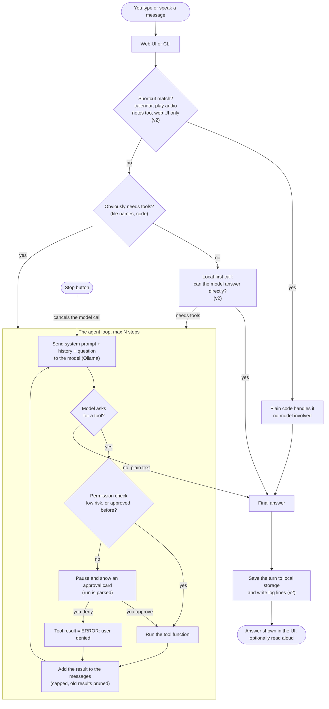
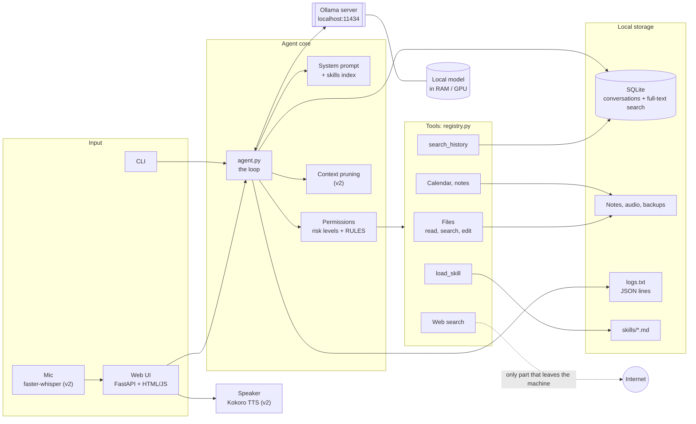

# Diagrams

← [Back to the guide](../BUILD_YOUR_OWN_AGENT.md)

Both diagrams are [Mermaid](https://mermaid.js.org/), which GitHub, GitLab and most editors render directly. The first shows what happens when you talk to the agent; the second shows the parts and which one talks to which. They describe agent0, which is v1 plus the v2 add-ons. Parts marked *(v2)* can be left out of your first version.

## 1. Interaction flow: what happens to one message

Reading it:

- **The loop is the agent.** Everything above it is optional routing to save time or improve reliability; everything below it is storage and output.
- **Every tool call passes the permission check** before the function runs. A denial goes back to the model as text, so it can explain what it couldn't do instead of crashing.
- **A parked run is resumed, not restarted.** The approval card only sends the run's id and your decision; the loop continues from where it paused.
- **The first version (v1) is just:** message → loop → permission check → tools → answer. Add the other boxes one add-on at a time.

## 2. Architecture: the parts

Reading it:

- **Everything runs on your machine.** The only arrow that leaves it is web search, which is why those tools ask for approval once per session.
- **`agent.py` is the hub.** It builds the prompt, talks to Ollama, passes each tool call through permissions, and records the result.
- **Tools are plain functions** declared in one registry. Adding a capability means adding an entry there; nothing else in the core changes.
- **Ollama is a separate process.** Your code only knows its HTTP address, so you can swap the model, or move Ollama to another machine, by changing a URL or a model name.
- **Voice is UI, not agent.** The mic and speaker sit beside the web UI and bypass the loop; the agent only ever sees text.

| Box | agent0 file |
|---|---|
| Web UI, CLI | `core/ui.py`, `templates/`, `static/`, `agent.py` (`python -m agent`) |
| Agent loop | `agent.py` |
| System prompt, skills | `config/system_prompt.py`, `tools/skills.py`, `skills/` |
| Permissions | `core/permission.py`, `core/runs.py`, `config/settings.py` |
| Context pruning | `core/context.py` |
| Tools | `tools/registry.py`, `tools/*.py`, `features/` |
| Model client | `core/llm.py` |
| Storage, history | `storage/`, `core/conversations.py` |
| Logger | `core/logger.py` |
| Mic, speaker | `core/speech_to_text.py`, `features/audio/` |
